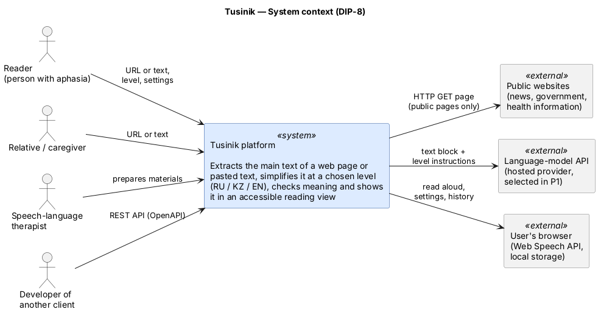
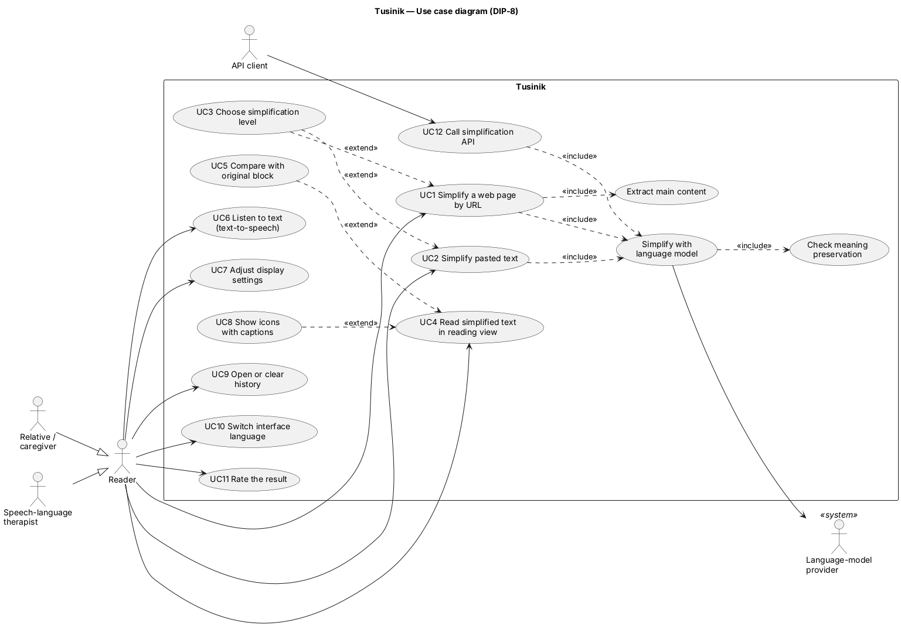
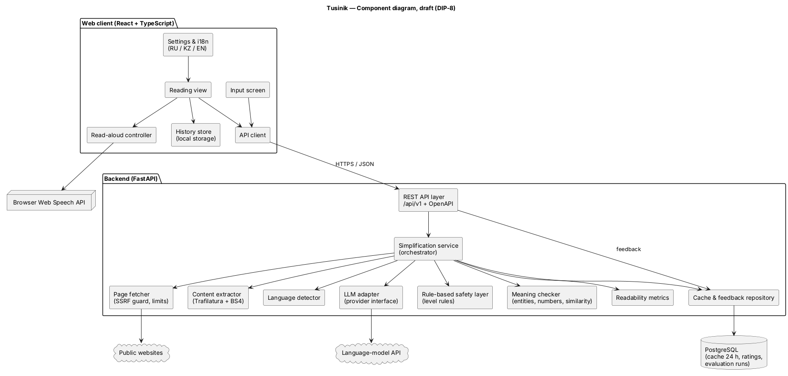
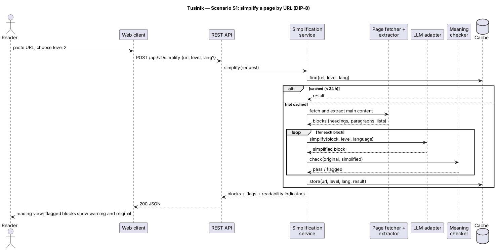

# 07 — Architecture (draft)

**YouTrack task:** DIP-8

Diagram sources and exports: [`../diagrams/`](../diagrams/README.md). Requirement IDs refer to `06-requirements.md`; technology decisions to `05-technology-comparison.md`.

## 1. System context

Tusinik has four kinds of users (reader, relative or caregiver, speech-language therapist, developer of another client) and three external systems:

| External system | What Tusinik uses it for | Constraint |
|---|---|---|
| Public websites | Download the page the reader submitted (FR-01) | Public pages only; 5 MB, 10 s, at most 3 redirects, no private addresses (NFR-02, NFR-06) |
| Language-model API | Rewrite each block at the chosen level (FR-05) | Behind a provider interface; provider chosen in comparison P1; retry once, then clear error (NFR-07) |
| User's browser | Read aloud with the Web Speech API (FR-11); keep settings and history (FR-10, FR-13) | Nothing about the reader is stored on the server |

## 2. Use cases

| Use case | Requirements |
|---|---|
| UC1 Simplify a web page by URL | FR-01, FR-03, FR-04 |
| UC2 Simplify pasted text | FR-02 |
| UC3 Choose simplification level | FR-05 |
| UC4 Read simplified text in reading view | FR-08, NFR-03, NFR-04 |
| UC5 Compare with original block | FR-09 |
| UC6 Listen to text | FR-11 |
| UC7 Adjust display settings | FR-10 |
| UC8 Show icons with captions | FR-12 |
| UC9 Open or clear history | FR-13 |
| UC10 Switch interface language | FR-14 |
| UC11 Rate the result | FR-17 |
| UC12 Call simplification API | FR-15, FR-16 |
| Included: extract main content, simplify with language model, check meaning | FR-03, FR-05, FR-06, FR-07 |

## 3. Components (draft)

### Web client (React + TypeScript, ADR-0006)

| Component | Responsibility | Requirements |
|---|---|---|
| Input screen | URL or text input, level choice, language override, privacy notice | FR-01, FR-02, FR-05, FR-06, NFR-05 |
| Reading view | Blocks of simplified text, warnings for flagged blocks, original on demand, optional icons | FR-07, FR-08, FR-09, FR-12, NFR-11 |
| Settings & i18n | Font size, spacing, contrast; interface strings in RU/KZ/EN | FR-10, FR-14 |
| Read-aloud controller | Play/pause/stop, speed, sentence highlighting via Web Speech API | FR-11 |
| History store | Last 20 items in browser local storage | FR-13 |
| API client | Calls the public REST API only | FR-15 |

### Backend (FastAPI, ADR-0001)

| Component | Responsibility | Requirements |
|---|---|---|
| REST API layer | `/api/v1` endpoints, validation, error format, OpenAPI at `/docs` | FR-15 |
| Simplification service | Orchestrates fetch → extract → detect language → simplify per block → check → metrics → cache | FR-03–FR-07, FR-16, FR-18 |
| Page fetcher | HTTP download with SSRF guard, size/time/redirect limits | NFR-02, NFR-06 |
| Content extractor | Trafilatura + BeautifulSoup; splits text into blocks (ADR-0002) | FR-03 |
| Language detector | Detects RU/KZ/EN; honours manual override | FR-06 |
| LLM adapter | One interface, one adapter per provider; prompt per level and language (ADR-0003) | FR-05, NFR-08 |
| Rule-based safety layer | Enforces sentence-length limits per level; splits long sentences that remain | FR-05 |
| Meaning checker | Compares numbers, dates, names; semantic similarity threshold; flags blocks | FR-07 |
| Readability metrics | Indicators for original and output | FR-16 |
| Cache & feedback repository | Cache entries with 24-hour expiry, anonymous ratings, evaluation runs (ADR-0004) | FR-17, FR-18 |

## 4. Main scenario (S1)

## 5. Data

| Entity | Where | Fields (draft) | Retention |
|---|---|---|---|
| Cache entry | PostgreSQL | hash of (URL, level, language), result JSON, created_at | 24 hours |
| Rating | PostgreSQL | id, level, language, answer, created_at | Until end of evaluation |
| Evaluation run | PostgreSQL | run id, text id, provider, level, language, metrics JSON, flags | Until end of project |
| Settings | Browser | font size, spacing, contrast, icons on/off, interface language, speech rate | Until the user clears it |
| History | Browser | title, URL or first words, level, date (max 20) | Until the user clears it |

Pasted text is never written to the database or to logs (NFR-05).

## 6. API (draft)

| Method and path | Purpose | Main fields |
|---|---|---|
| `POST /api/v1/simplify` | Simplify a URL or text | request: `url` or `text`, `level` (1–3), `language` (optional); response: `language`, `blocks[]` (`original`, `simplified`, `flagged`, `reasons[]`), `metrics.original`, `metrics.simplified`, `truncated` |
| `GET /api/v1/languages` | Supported languages and levels | `languages[]`, `levels[]` |
| `POST /api/v1/feedback` | Anonymous rating | `level`, `language`, `answer` |
| `GET /api/v1/health` | Service status | `status` |

Errors use one JSON format: `{ "error": { "code": "...", "message": "..." } }`, with codes such as `INVALID_URL`, `LOGIN_REQUIRED`, `NOT_HTML`, `FETCH_TIMEOUT`, `TOO_LITTLE_TEXT`, `TEXT_TOO_LONG`, `PROVIDER_UNAVAILABLE`.

## 7. Deployment (planned)

Docker Compose with three services: `frontend` (static build served by a web server), `backend` (FastAPI), `db` (PostgreSQL). Secrets (provider API key, database password) come from environment variables; `config/.env.example` lists the variable names with placeholder values (NFR-06, NFR-09).

## 8. Open points

- Language-model provider and similarity model: decided by comparison P1 (`09-verification-plan.md`).
- Background jobs instead of synchronous requests if NFR-01 is not met (ADR-0005).
- Source of the icon set for FR-12 (must be open-licensed and cover the three interface languages through captions).
